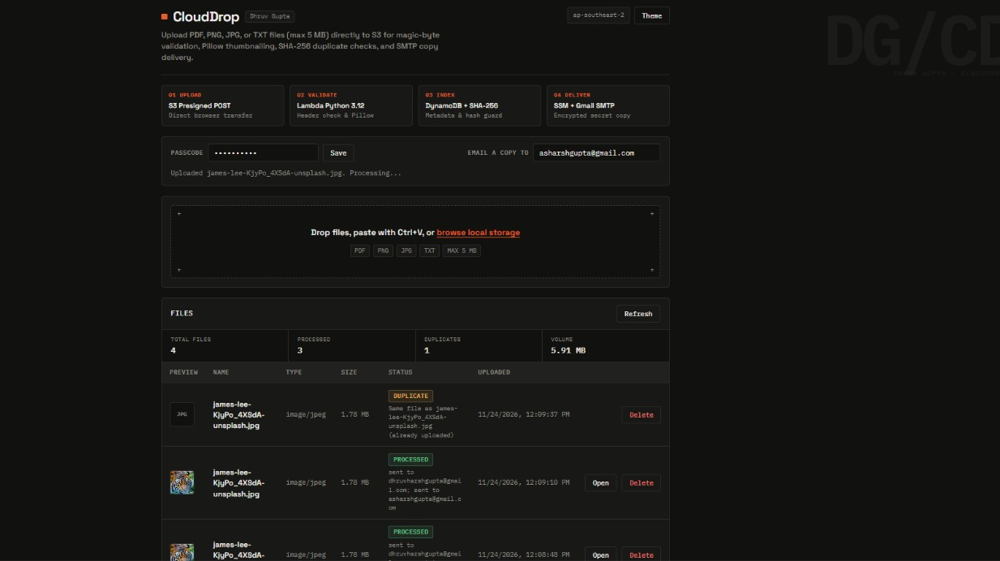
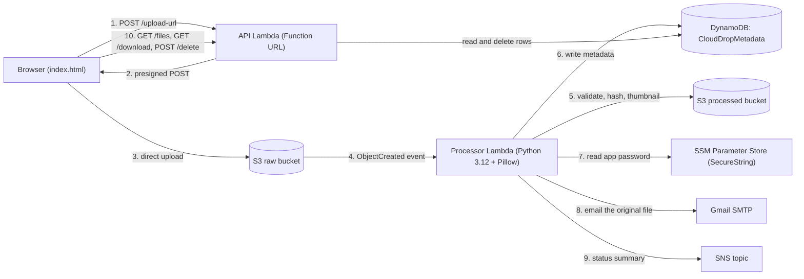
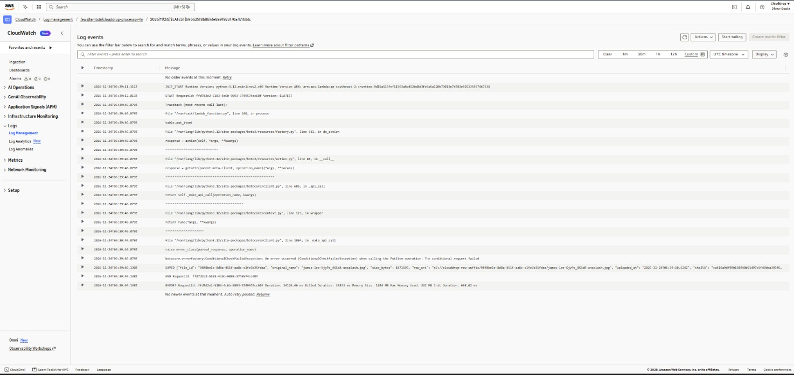
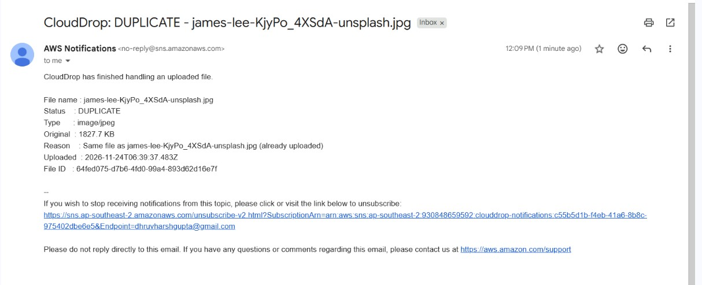

# CloudDrop

An event-driven serverless pipeline on AWS. Upload a file in the browser and it is validated, compressed, indexed and emailed to you, with no server running in between.

**Live demo:** [legenddhruv.github.io/clouddrop-serverless-pipeline](https://legenddhruv.github.io/clouddrop-serverless-pipeline/) 

## What it does

- Uploads files from the browser straight to S3 with a short-lived presigned POST
- Checks the real file type from the first bytes, not only the extension (PDF, PNG, JPG, TXT, max 5 MB)
- Compresses images (max 1600 px) and creates a 256 px thumbnail. Example: a 4.3 MB photo became 354 KB
- Detects duplicates with a SHA-256 hash. Uploading the same file again is flagged `DUPLICATE`
- Emails the exact uploaded file as an attachment to the owner and, optionally, to another address
- Dashboard to list, preview, open and delete files

## Architecture

More detail and design trade-offs are in [docs/architecture.md](docs/architecture.md).

## Tech stack

Amazon S3, AWS Lambda (Python 3.12), Amazon DynamoDB, Amazon SNS, AWS Systems Manager Parameter Store, a Pillow Lambda layer, Gmail SMTP. Frontend: plain HTML, CSS and JavaScript. Region: `ap-southeast-2` (Sydney).

## Security decisions

- Both buckets block all public access. Files are reached only through short-lived signed links.
- Uploads use a presigned POST that expires after 5 minutes and caps the file size.
- Each Lambda function has its own least-privilege IAM role (see [iam/](iam/)). No access keys are used anywhere.
- The Gmail app password is stored as an encrypted SecureString in Parameter Store.
- File type is verified from the file's first bytes, so a renamed file is rejected.
- The page escapes all file names before showing them.

## Test results

| Test | Expected result | Result |
|---|---|---|
| Valid PNG or JPG | PROCESSED, thumbnail created | Passed |
| Valid PDF | PROCESSED, opens in the browser | Passed |
| Wrong passcode | "Wrong passcode" | Passed |
| Same file uploaded again | DUPLICATE, no second email | Passed |
| Emailed copy with the file attached | Attachment arrives in the inbox | Passed |
| `.zip` or `.exe` file | Blocked with an allowed-types error | Passed |
| File over 5 MB | Blocked with a size error | Passed |
| `.txt` renamed to `fake.png` | REJECTED, content does not match extension | Passed |
| Delete a file | Row and files removed from both buckets | Passed |
| Direct link to a raw bucket file | Access Denied | Passed |

----------------------------------------------------------------------------------------------------------------------------------------

## Known limitations

- One shared passcode protects the app. There are no per-user accounts.
- The Function URL is public and allows any origin (CORS `*`).
- Listing files uses a DynamoDB Scan, which only suits a small table.
- The duplicate check reads first and writes afterwards, so two identical uploads at the same instant could both pass.
- Email goes through Gmail SMTP, which limits sending. A production version would use Amazon SES with a verified domain.
- Everything was set up by hand in the AWS console. There is no infrastructure as code yet.
- There are no automated tests.

## Setup (manual, AWS console)

1. Create two private S3 buckets (raw and processed) in the same region. Add a CORS rule on the raw bucket that allows `POST`.
2. Create a DynamoDB table `CloudDropMetadata` with partition key `file_id` (String), on-demand.
3. Create an SNS topic `clouddrop-notifications` and confirm your email subscription.
4. Store the Gmail app password as a SecureString parameter `/clouddrop/gmail_app_password`.
5. Create two IAM roles from the policies in [iam/](iam/) (replace the placeholders).
6. Build a Pillow layer for Python 3.12 and publish it.
7. Create `clouddrop-processor-fn` from `backend/lambda_processor.py` (handler `lambda_function.handler`, 512 MB, 30 s, Pillow layer) and add an S3 `ObjectCreated` trigger on the raw bucket.
8. Create `clouddrop-api-fn` from `backend/lambda_api.py` and enable a Function URL (auth NONE, CORS headers `content-type` and `x-passcode`).
9. Put the Function URL in `API_URL` in `index.html` and host the page.

Environment variables:

| Function | Variables |
|---|---|
| Processor | `TABLE_NAME`, `PROCESSED_BUCKET`, `TOPIC_ARN`, `OWNER_EMAIL`, `SMTP_PARAM`, `MAX_BYTES` |
| API | `TABLE_NAME`, `RAW_BUCKET`, `PROCESSED_BUCKET`, `PASSCODE`, `MAX_BYTES` |

## What I learned

Most of the learning came from debugging, and CloudWatch logs found the cause every time.

- Region matters. A signed upload link built for S3's global address pointed at us-east-1, so my Sydney buckets rejected it until I forced the regional endpoint.
- The Lambda handler name must match the function in the file. The default `lambda_handler` caused `HandlerNotFound`, and S3 kept retrying for minutes.
- A single trailing space in an environment variable (the table name) made DynamoDB reject every request.
- With least-privilege IAM, each new feature (Parameter Store, delete, email) needs its own permission, and a wrong ARN fails with unhelpful messages.
- Email sent through SES from a Gmail address never showed up in my inbox, and the SES sandbox only allows verified recipients. Sending through Gmail SMTP, with the app password kept in Parameter Store, fixed delivery.

## Future work

- Rebuild the setup as infrastructure as code (AWS SAM or Terraform) with an automated deploy from GitHub Actions
- Add automated tests for the validation and duplicate logic
- Per-user login with Amazon Cognito
- CloudWatch alarm on Lambda errors, and S3 and DynamoDB expiry rules
- Switch email to Amazon SES with a verified domain

## Author

Dhruv Gupta, B.Tech IT, Maharaja Agrasen Institute of Technology, New Delhi

GitHub: [LegendDHRUV](https://github.com/LegendDHRUV) · Email: dhruvharshgupta@gmail.com

Licensed under the MIT License.
