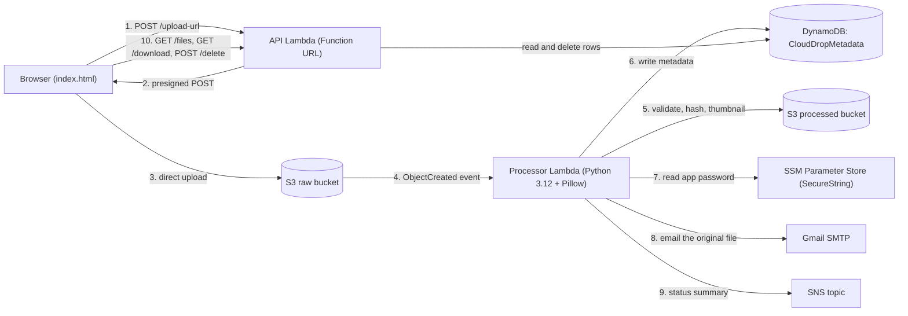

# CloudDrop: architecture and design notes

Region: `ap-southeast-2` (Sydney)

## Request lifecycle

1. The browser asks the API function for an upload permission. The API checks the passcode, file type and size, then returns a presigned POST that expires after 5 minutes and limits the file size.
2. The browser uploads the file straight to the raw bucket. The file never passes through a server.
3. S3 emits an `ObjectCreated` event that invokes the processor function.
4. The processor reads the file, checks that its first bytes match its extension, and computes a SHA-256 hash. If that hash is already stored, the upload is saved as `DUPLICATE` and nothing else happens.
5. Otherwise images get a compressed copy (max 1600 px) and a 256 px thumbnail in the processed bucket. Other types are copied as they are.
6. The processor emails the exact original file as an attachment, stores the metadata in DynamoDB, stores a hash marker for duplicate detection, and publishes a summary to SNS.
7. The dashboard lists the files through the API and opens them with short-lived signed download links.

## Design decisions

| Decision | Reason |
|---|---|
| Two separate buckets | The processor writes only to the processed bucket, so its output can never trigger it again (no infinite loop) |
| Presigned POST upload | Large files skip the API function, and S3 enforces the size limit |
| One IAM role per function | Each function gets only the actions it needs |
| Gmail app password in SSM Parameter Store | The secret is encrypted and never appears in code or environment variables |
| File-signature check | A renamed file (for example `.txt` renamed to `.png`) is rejected |
| Hash marker rows in the same table | Duplicate detection without a second table or a secondary index |

## Trade-offs

- The duplicate check reads the marker first and writes it afterwards, so two identical files uploaded at the same instant could both pass.
- The file list uses a DynamoDB Scan, which is fine for a small table but not for thousands of files.
- Email goes through Gmail SMTP. Gmail limits sending, so a production version would use Amazon SES with a verified domain.
- Access is one shared passcode. A production version would use real user accounts (for example Amazon Cognito).
